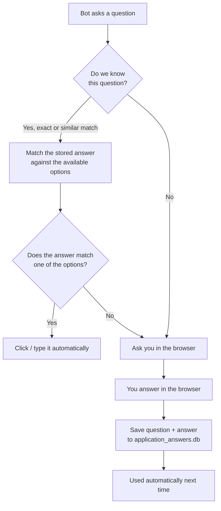

# Naukri Auto-Apply Bot

[](../../actions/workflows/ci.yml)
[](https://www.python.org/downloads/)
[](LICENSE)
[](https://www.selenium.dev/)

Applies to jobs on [Naukri.com](https://www.naukri.com) from the **Recommended Jobs** page and
handles the recruiter chatbot questionnaire — including questions it has never seen before.

It **learns your answers**. Answer a question once in the browser and the bot remembers it,
so the next recruiter asking the same thing is handled automatically.

---

## Table of contents

- [What it does](#what-it-does)
- [How the self-learning works](#how-the-self-learning-works)
- [Requirements](#requirements)
- [Installation](#installation)
- [Configuration](#configuration)
- [Usage](#usage)
- [Project structure](#project-structure)
- [The answer store](#the-answer-store)
- [Logs and screenshots](#logs-and-screenshots)
- [Development](#development)
- [Troubleshooting](#troubleshooting)
- [Legal and ethical use](#legal-and-ethical-use)
- [Contributing](#contributing)
- [License](#license)

---

## What it does

1. **Logs in** to Naukri.com with the credentials from your `.env` file.
2. **Navigates** to the Recommended Jobs page and opens the tab you choose.
3. **Selects** up to 5 unapplied jobs per batch by ticking their checkboxes, then clicks **Apply** only after you explicitly confirm.
4. **Answers the recruiter chatbot** that pops up in the side drawer:
   - **Radio questions** — if the answer is known, the matching option is clicked automatically.
   - **Free-text questions** — if the answer is known, it is typed in with human-like pacing.
   - **Unknown questions** — the bot asks you to answer in the browser, then saves your answer
     for next time.
5. **Repeats** until a tab runs out of unapplied jobs, then moves to the next tab.

### The tabs you can apply from

| # | Tab            | Notes                                        |
|---|----------------|----------------------------------------------|
| 1 | Applies        |                                             |
| 2 | Profile        |                                             |
| 3 | Top Candidate  | **Default** when you press Enter             |
| 4 | Preferences    |                                             |
| 5 | You might like |                                             |

---

## How the self-learning works



Answers are matched by **meaning, not exact text**. The matcher:

- ignores case, punctuation and question numbering (`"1. Do you have Python?"` → `do you have python`)
- normalises ratio notation (`24*7` and `24/7` are treated as the same)
- drops filler words (`what`, `please`, `kindly`, `mention`, …)
- **requires the distinctive words to agree**, so *"experience in Python"* can never inherit the
  answer for *"experience in IICS"*

If the stored answer is not one of the options the recruiter offers, the bot refuses to guess and
asks you instead — a wrong radio click is a false answer sent to a recruiter.

---

## Requirements

- **Python 3.10+**
- **Microsoft Edge** (the bot drives Edge, not Chrome)
- A **Naukri.com account**
- Internet access

The EdgeDriver is downloaded automatically on first run via `webdriver-manager`, so there is
nothing to install manually.

---

## Installation

### With `uv` (recommended — this repo ships a `uv.lock`)

```bash
git clone https://github.com/<your-username>/naukri-automation.git
cd naukri-automation
uv sync
```

### With `pip`

```bash
git clone https://github.com/<your-username>/naukri-automation.git
cd naukri-automation
python -m venv .venv
# Windows
.venv\Scripts\activate
# macOS / Linux
source .venv/bin/activate
pip install -e ".[dev]"
```

---

## Configuration

Copy the example environment file and fill in your credentials:

```bash
cp .env.example .env
```

```dotenv
NAUKRI_EMAIL=your.email@example.com
NAUKRI_PASSWORD=your-naukri-password
```

`.env` is git-ignored — **never commit your real credentials**.

---

## Usage

```bash
uv run python autoapply.py      # with uv
python autoapply.py             # with a plain venv
```

The bot asks which tabs to use, then requires you to type `APPLY` before opening Edge and submitting anything. It continues in batches of up to 5 jobs until the selected tabs run out. It then opens Edge and logs in:

```
==================================================
Select job tabs to apply to:
  1. Applies
  2. Profile
  3. Top Candidate
  4. Preferences
  5. You might like
==================================================
Enter numbers (e.g. 1,3,5) or press Enter for Top Candidate:
```

Press **Enter** to use the default (Top Candidate), or type numbers separated by commas
(`1,3,5`) to pick several. Then type `APPLY` at the confirmation prompt to authorize real submissions; any other response cancels the run.

### When the bot asks for input

If it meets a question it has never seen, it logs the question and waits **60 seconds** for you
to answer in the browser window:

```
❓ Unknown radio question.
👆 Click your answer in the browser...
```

Answer it in the open Edge window (click the option, or type in the chat box and hit Send) and
the bot picks it up, saves it, and carries on. If you do not answer in time, a screenshot is
saved and the bot moves on.

---

## Project structure

```
naukri-automation/
├── autoapply.py              # the whole bot (entry point)
├── application_answers.db    # learned answers  (git-ignored)
├── naukri_bot.log            # rotating log      (git-ignored)
├── screenshots/              # debug screenshots (git-ignored)
├── tests/
│   └── test_fuzzy_lookup.py  # unit tests for the answer matcher
├── .github/workflows/ci.yml  # lint + test on every push
├── .env.example              # copy to .env
├── pyproject.toml            # deps, ruff and pytest config
└── requirements.txt          # pip-only dependency list
```

Inside `autoapply.py` the code is grouped into sections:

| Section                     | What lives there                                            |
|-----------------------------|-------------------------------------------------------------|
| Configuration               | credentials, tabs, timeouts, **all DOM selectors**           |
| Human behaviour simulation | `human_wait`, `human_type`, `human_click`                    |
| Question matching           | `_normalize_question`, `fuzzy_lookup`, `_match_option`       |
| Answer store                | `init_answer_database`, `load_answers`, `save_answer`        |
| Browser setup               | `create_edge_driver`, `login_naukri`                         |
| Step 1 — job selection      | `select_jobs_and_apply`                                      |
| Step 2 — chatbot drawer     | `handle_chatbot_drawer`, `handle_radio_buttons`, …           |
| Tab navigation              | `select_tabs`, `navigate_to_tab`                             |

All CSS selectors live in the single `SELECTORS` dict near the top of the file. When Naukri
changes its markup, that is the only place you need to edit.

---

## The answer store

Answers are kept in SQLite (`application_answers.db`) in a single `answers` table:

| Column          | Meaning                                              |
|-----------------|------------------------------------------------------|
| `question_text` | The question, unique                                  |
| `answer`        | Your answer                                           |
| `field_type`    | `text` or `radio`                                     |
| `created_at`    | When it was first learned                             |
| `usage_count`   | How many times it has been used                       |
| `last_used`     | When it was last used                                 |

Inspect it with any SQLite client:

```bash
sqlite3 application_answers.db "SELECT question_text, answer FROM answers;"
```

To start over, delete the file — the bot will rebuild it and re-learn your answers.

---

## Logs and screenshots

- **`naukri_bot.log`** — rotating log (5 MB per file, 3 backups kept). The console shows `INFO`
  and above; the file records everything at `DEBUG` level.
- **`screenshots/`** — a PNG is saved whenever something needs attention, named after the
  failure: `no_checkboxes_found`, `apply_click_failed`, `drawer_timeout`, `radio_timeout`,
  `text_timeout`, `tab_failed_<tab>`, `fatal_error`.

---

## Development

```bash
uv sync                      # or: pip install -e ".[dev]"

ruff check .                 # lint
ruff check . --fix           # lint + autofix
black autoapply.py tests/    # format
pytest -q                    # run the test suite
```

The test suite covers the question matcher — the part most likely to cause a wrong answer to be
sent to a recruiter:

```bash
$ pytest -q
12 passed in 0.57s
```

CI runs `ruff check .` and `pytest -q` on every push and pull request.

---

## Troubleshooting

| Symptom | Likely cause | Fix |
|---|---|---|
| `Set NAUKRI_EMAIL and NAUKRI_PASSWORD in .env` | `.env` missing or unreadable | Copy `.env.example` to `.env` and fill both values |
| `No selectable checkboxes found on any card` | Naukri changed the job-card markup | Update the `card_checkbox` / `card_checked` selectors in `SELECTORS` — a screenshot is saved |
| `Could not activate tab '<tab>'` | Tab markup or id changed | Check the `div#<tab_id> .tab-list-item` selector; the tab is skipped, not silently applied to |
| `ConnectionResetError` while starting the driver | `webdriver-manager` download failed | Re-run with network access, or install `msedgedriver` manually and point Selenium at it |
| `Timed out waiting for a radio answer` | You did not answer within 60 s | Answer sooner, or pre-seed the answer in `application_answers.db` |
| Bot answers a question you did not expect | A stale/fuzzy match in the store | Delete the offending row from `application_answers.db` |
| Edge opens but nothing happens | A stale Edge profile is locked | Close every Edge window and re-run |

---

## Legal and ethical use

This project automates a website that belongs to someone else. It is published for
**personal use and educational purposes only**.

- Using it may **violate the Naukri.com Terms of Service**. Check the current terms before
  running it, and accept the risk yourself.
- The bot logs in as you and submits **real applications on your behalf**. Review what it
  submits — the answers it learns are yours, and you are responsible for them.
- Do not use it to apply to the same job repeatedly, to impersonate other people, or to
  overwhelm a recruiter's inbox.
- Respect recruiters' time: if a recruiter says they are not interested, do not re-apply.

No warranty is provided. Use at your own risk.

---

## Contributing

Contributions are welcome — especially **new selectors** when Naukri changes its markup, and
**new matcher test cases** for tricky question phrasings.

1. Fork the repository and create a branch.
2. Make your change, keeping `ruff check .` and `pytest` green.
3. Open a pull request describing what you changed and why.

Please never commit `.env`, the answer database, logs, or screenshots — they are already
git-ignored.

---

## License

Released under the [MIT License](LICENSE).
